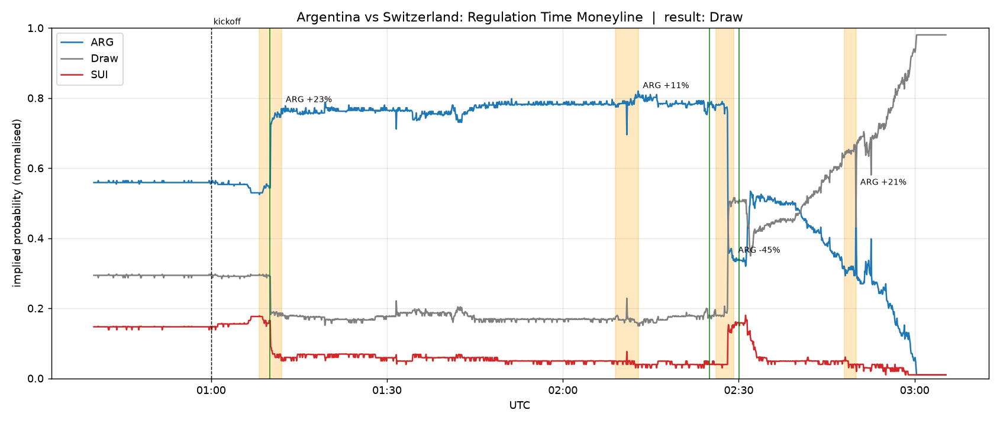
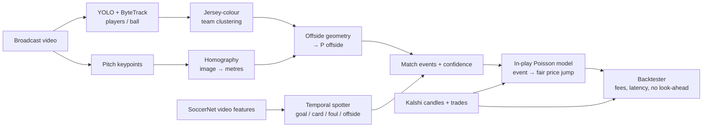
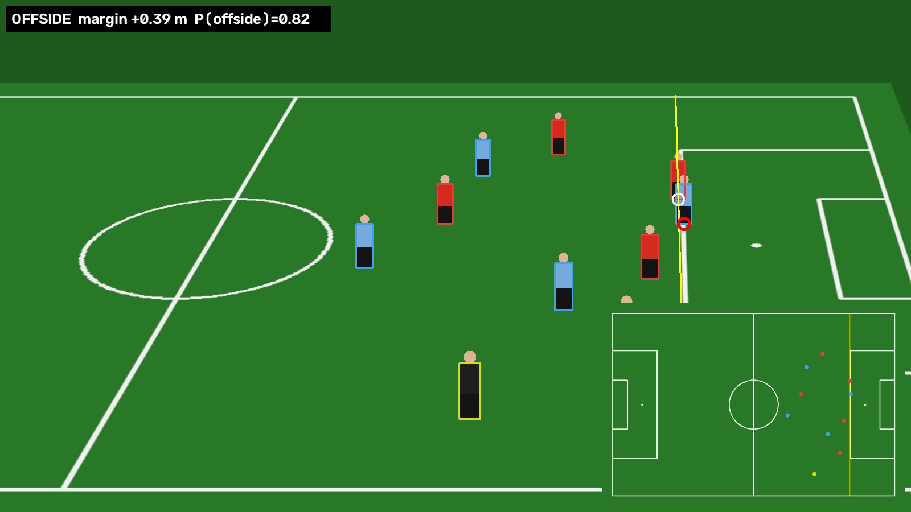

# VARFlash

**An "AI VAR" proof of concept: computer vision on soccer video, backtested against Kalshi prediction-market prices.**

When a goal or a red card goes to a VAR review, prediction-market prices hover in the middle while
people wait for the referee. VARFlash asks: *if a model watched the same video, could it call the
decision before the market prices it in, and would that have made money after fees?*

> Research/portfolio project. It only **reads** public Kalshi market data and never places orders.



*Kalshi regulation-time moneyline for Argentina vs Switzerland (World Cup QF, 11 Jul 2026). Orange
bands are price shocks detected automatically (Mac Allister 10', Ndoye 67', Embolo's VAR red card
72'); green lines are when the strategy would have traded.*

## How it fits together



| Package | What it does |
|---|---|
| `varflash.kalshi` | Read-only Kalshi client. Routes settled markets to the `/historical` API, paginates, rate-limits, caches to Parquet. Bulk-pulls whole series (every World Cup / EPL / UCL game). |
| `varflash.market` | Overround-free implied probabilities from bid/ask or trades; **shock detection** (where the market repriced, i.e. where something happened on the pitch). |
| `varflash.quant` | In-play Poisson model. Backs out each team's scoring rate from pre-match prices, then prices any state (minute, score, red cards). Generalises to any match with no per-team training. |
| `varflash.vision` | Detection + tracking (Ultralytics YOLO, ByteTrack), Lab-colour team clustering, keypoint homography, Law-11 offside geometry with a calibrated **P(offside)** under position noise, overlays + minimap. |
| `varflash.spotting` | Temporal action-spotting network (dilated TCN + BiGRU) trained on SoccerNet-v2 (500 matches, 17 event classes), SoccerNet-style tolerance AP. CPU-trainable. |
| `varflash.backtest` | Video ↔ match ↔ UTC clock, Kalshi fee schedule, quote book that never peeks ahead, fractional-Kelly strategy, markouts and PnL. |

## Quickstart

```bash
python -m venv .venv && .venv\Scripts\activate        # Windows
pip install -e ".[vision,spotting,dev]"
pytest -q
```

### 1. Market data (any match, any league)

```bash
varflash kalshi series --games-only            # soccer series: KXWCGAME, KXEPLGAME, KXUCLGAME, ...
varflash kalshi pull-series KXWCGAME           # every settled World Cup game (candles + trades)
varflash market analyze KXWCGAME-26JUL11ARGSUI # shocks + chart for one match
varflash market scan KXWCGAME                  # shock table across the whole tournament
```

Kickoff times aren't in Kalshi's API. Verified ones live in `config/kickoffs.csv`; otherwise the
kickoff is estimated from the market close (final whistle).

### 2. AI VAR on a frame

```bash
varflash vision calibrate --video match.mp4 --time 3725 --out calib.json   # click pitch keypoints
varflash vision review   --video match.mp4 --time 3725 --calib calib.json \
                         --attack right --attacking-color "#75AADB"
python examples/synthetic_var_review.py   # ground-truth check on a rendered frame
```



### 3. Train the event spotter

```bash
varflash spotting download            # ~11 GB of SoccerNet features + labels, no NDA needed
varflash spotting train --epochs 15   # CPU is fine
varflash spotting eval --split test
```

### 4. Backtest

```bash
varflash backtest --event KXWCGAME-26JUL11ARGSUI --events examples/ARGSUI_events.csv
```

Events can be given as `video_s` (seconds into your recording, anchored with
`--video-kickoff-s/--video-second-half-s`), `game_time` (`"2 - 27:00"`) or `utc`.

## Design notes

- **No look-ahead.** Candles are stamped at the end of their minute and the quote book only joins
  backwards; trades refine the quote only when they're newer. Tests enforce this.
- **Bet on speed, not on out-guessing the market.** By default fair value is
  *market price just before the event + model-implied jump*. The Poisson model only says how
  far a goal / red card / overturned goal should move the price, so the strategy's edge
  comes from reacting first.
- **Probabilities, not verdicts.** The offside module turns a margin in metres into
  `P(offside) = Φ(margin / (√2·σ))`, where σ is per-player position error from detection and
  homography. A 3 cm call is a coin flip, and the sizing reflects that.
- **Fees matter.** Kalshi's taker fee `ceil(0.07·C·P·(1−P))` is charged on entry and exit.
- **Markouts** (how the market moved 30 s / 1 min / 2 min / 5 min after each signal) are the
  honest metric for a latency strategy; PnL on a handful of trades is mostly noise.

## Limitations and roadmap

- The demo `examples/ARGSUI_events.csv` uses minute-level times from match reports, which can
  land up to a minute early and *look* like edge. Real conclusions need video timestamps.
- The spotter is trained on SoccerNet's ResNet-152 (TF2) + PCA-512 features. Running it on new
  broadcasts needs the same feature extractor (next step), or retraining on features you extract.
- Homography is from manually clicked keypoints. Next: a pitch-keypoint detector for per-frame
  calibration, and fine-tuning YOLO on football classes (player / goalkeeper / referee / ball).
- The in-play model has a constant scoring rate. `market scan` across hundreds of Kalshi matches
  is the dataset to calibrate time-varying intensities and red-card effects.
- Broadcast feeds lag the stadium by 5–30 s while pro bots use stadium data feeds. Use
  `--delay` to see how quickly the edge disappears.

## Data and legal

- **Kalshi**: public market-data endpoints, read-only. No trading code exists in this repo.
- **SoccerNet** features and labels are public. Raw videos require signing SoccerNet's NDA.
  Use your own recordings for personal research only.
