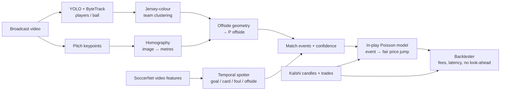
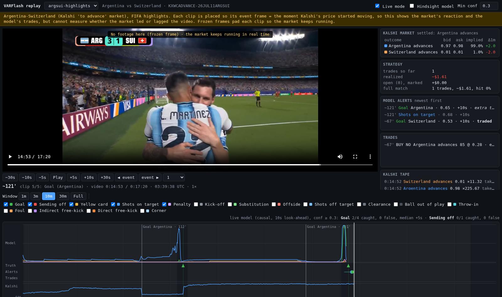

# VARFlash

**An "AI VAR" proof of concept: computer vision on soccer video, backtested against Kalshi prediction-market prices.**

When a goal or a red card goes to a VAR review, prediction-market prices hover in the middle while
people wait for the referee. VARFlash asks: *if a model watched the same video, could it call the
decision before the market prices it in, and would that have made money after fees?*

> Research/portfolio project. It only **reads** public Kalshi market data and never places orders.


*Kalshi regulation-time moneyline for Argentina vs Switzerland (World Cup QF, 11 Jul 2026). Orange
bands are price shocks detected automatically (Mac Allister 10', Ndoye 67', Embolo's VAR red card
72'); green lines are when the strategy would have traded.*

## How it fits together



| Package | What it does |
|---|---|
| `varflash.kalshi` | Read-only Kalshi client. Routes settled markets to the `/historical` API, paginates, rate-limits, caches to Parquet. Bulk-pulls whole series (every World Cup / EPL / UCL game). |
| `varflash.market` | Overround-free implied probabilities from bid/ask or trades; **shock detection** (where the market repriced, i.e. where something happened on the pitch). |
| `varflash.quant` | In-play Poisson model. Backs out each team's scoring rate from pre-match prices, then prices any state (minute, score, red cards). Generalises to any match with no per-team training. |
| `varflash.vision` | Detection + tracking (Ultralytics YOLO, ByteTrack), Lab-colour team clustering, keypoint homography, Law-11 offside geometry with a calibrated **P(offside)** under position noise, overlays + minimap. |
| `varflash.spotting` | Temporal action-spotting network (dilated TCN + BiGRU, or a causal past-only variant for live alerts) trained on SoccerNet-v2 (500 matches, 17 event classes). Card detector, isotonic confidence calibration, live-latency metrics, SoccerNet's official evaluator, and a PyTorch re-implementation of SoccerNet's ResNet-152 + PCA feature extractor for new matches. |
| `varflash.opendata` | StatsBomb open event data: card rates, foul-to-card probabilities, red-card scoring effect. |
| `varflash.backtest` | Video ↔ match ↔ UTC clock, Kalshi fee schedule, quote book that never peeks ahead, fractional-Kelly strategy, markouts and PnL. |

## Quickstart

```bash
python -m venv .venv && .venv\Scripts\activate        # Windows
pip install -e ".[vision,spotting,dev]"
pytest -q
```

### 1. Market data (any match, any league)

```bash
varflash kalshi series --games-only            # soccer series: KXWCGAME, KXEPLGAME, KXUCLGAME, ...
varflash kalshi pull-series KXWCGAME           # every settled World Cup game (candles + trades)
varflash market analyze KXWCGAME-26JUL11ARGSUI # shocks + chart for one match
varflash market scan KXWCGAME                  # shock table across the whole tournament
```

Knockout games have two match markets: `KXWCGAME` (regulation-time 1X2: home / draw / away after
90' + stoppage) and `KXWCADVANCE` (who goes through, including extra time and penalties). Both are
supported; the in-play model prices extra time and a penalty shootout for the latter.

Kickoff times aren't in Kalshi's API. Verified ones live in `config/kickoffs.csv`; otherwise the
kickoff is estimated from the market close (final whistle).

### 2. AI VAR on a frame

```bash
varflash vision calibrate --video match.mp4 --time 3725 --out calib.json   # click pitch keypoints
varflash vision review   --video match.mp4 --time 3725 --calib calib.json \
                         --attack right --attacking-color "#75AADB"
python examples/synthetic_var_review.py   # ground-truth check on a rendered frame
```


### 3. Train the event spotter

```bash
varflash spotting download                    # ~11 GB of SoccerNet features + labels, no NDA needed
varflash spotting train                       # 17 classes; early stopping on validation mAP; GPU if available
varflash spotting eval --split test           # AP per class, calibration (and live latency for causal models)
varflash spotting official-eval               # SoccerNet's official average-mAP (loose / tight)

# Card detector: all classes as auxiliary tasks, both reds merged into "Sending off"
varflash spotting train --classes cards_multitask --out models/cards.pt
# Live version: past-only model allowed 10 s of look-ahead before it must fire
varflash spotting train --classes cards_multitask --causal --delay 10 --out models/cards_live.pt
```

Second stage, from raw pixels (needs the 224p videos, i.e. the SoccerNet NDA): the feature spotter
proposes card moments, and a visual model (ImageNet RegNetY-800MF fine-tuned end to end on 4 fps
frames + a BiGRU) looks at a 12 s clip around each one. Scores are fused by a logistic regression
fitted on the validation split.

```bash
varflash spotting download --files 1_224p.mkv 2_224p.mkv   # ~190 GB
varflash cards build-clips      # candidates + card / no-card-foul / random clips, stored as JPEG
varflash cards train            # -> models/card_vision.pt
varflash cards rescore          # test AP: spotter vs visual vs fused
```

On ORCD Engaging, `sbatch scripts/spotting_sweep.sbatch` trains the baseline and all card-model
ablations (3 seeds) on one GPU, and `python scripts/summarize_sweep.py` prints the scorecard.

### 3b. Run the spotter on a new match

SoccerNet's features come from Keras' ImageNet ResNet-152 on 2 fps, centre-cropped 224×224 frames,
reduced to 512-d by PCA. `varflash.spotting.features` re-implements that backbone in PyTorch
(Keras weights loaded from the original `.h5`; matches Keras to 6e-7 relative error, including
SoccerNet's BGR/RGB channel quirk) and recovers the PCA exactly by least squares from
SoccerNet's own raw/PCA feature pairs, so no TensorFlow is needed.

```bash
varflash spotting download --splits valid --max-games 10 --files 1_ResNET_TF2.npy 2_ResNET_TF2.npy
varflash spotting fit-pca                                  # -> models/backbones/soccernet_pca512.npz
varflash spotting extract --video match.mp4 --out feats/   # ~1 min per half on one L40S
varflash spotting kickoffs --features feats/1_ResNET_TF2_PCA512.npy --game 26JUL11ARGSUI
varflash spotting kickoffs --game 26JUL11ARGSUI --video-name match.mp4 --record 312 3605 --verified
varflash spotting spot --features feats/1_ResNET_TF2_PCA512.npy --model models/cards_live.pt \
                       --backtest-csv events.csv          # goals / red cards, fill in `team`
varflash backtest --event KXWCGAME-26JUL11ARGSUI --events events.csv   # uses the verified kickoffs
```

Verified video kickoffs live in `config/video_kickoffs.csv`. Match videos are git-ignored; keep
broadcast footage for personal research only.

### 4. Backtest

```bash
varflash backtest --event KXWCGAME-26JUL11ARGSUI --events examples/ARGSUI_events.csv
```

How early does the AI VAR have to be? `python examples/signal_timing_sweep.py` sweeps the time the
red-card verdict fires across Embolo's VAR review, in both markets.

Events can be given as `video_s` (seconds into your recording, anchored with
`--video-kickoff-s/--video-second-half-s`), `game_time` (`"2 - 27:00"`) or `utc`.

### 5. Replay GUI

The match video with the live model's scores and alerts, its trades, and the Kalshi book on one clock.
"Live mode" hides everything the system could not have known yet at the playhead.



```bash
# a SoccerNet game (ground truth from its labels, no market)
varflash replay build --name napoli-milan --game-dir "data/soccernet/italy_serie-a/2016-2017/2016-08-27 - 21-45 Napoli 4 - 2 AC Milan"
# your own recording of a Kalshi-listed match (teams for trading come from the match report)
varflash replay build --name argsui --video match.mp4 --event KXWCGAME-26JUL11ARGSUI --report examples/ARGSUI_events.csv
# official highlights: each clip anchored to wall-clock time (event frame = Kalshi's move onset)
varflash replay build --name argsui-highlights --video argsui_highlights.mp4 \
  --clips config/replay_clips/argsui_highlights.csv --event KXWCADVANCE-26JUL11ARGSUI --hold-min 2
varflash replay serve   # prints http://localhost:<port>/; Cursor / `ssh -L` forwards the port
```

Build on a compute node (feature extraction needs a GPU for new videos); serving is lightweight.

## Design notes

- **No look-ahead.** Candles are stamped at the end of their minute and the quote book only joins
  backwards; trades refine the quote only when they're newer. Tests enforce this.
- **Bet on speed, not on out-guessing the market.** By default fair value is
  *market price just before the event + model-implied jump*. The Poisson model only says how
  far a goal / red card / overturned goal should move the price, so the strategy's edge
  comes from reacting first.
- **Incident time vs verdict time.** For reviewed decisions the market is anchored at the moment
  of the incident (`incident_utc` / `incident_video_s`), and the trade happens when the verdict is
  ready. A late verdict then shows no edge instead of counting the event twice. The strategy only
  trades in the event's direction, so it never fades a move it disagrees with in size.
- **Probabilities, not verdicts.** The offside module turns a margin in metres into
  `P(offside) = Φ(margin / (√2·σ))`, where σ is per-player position error from detection and
  homography. A 3 cm call is a coin flip, and the sizing reflects that.
- **Fees matter.** Kalshi's taker fee `ceil(0.07·C·P·(1−P))` is charged on entry and exit.
- **Markouts** (how the market moved 30 s / 1 min / 2 min / 5 min after each signal) are the
  honest metric for a latency strategy; PnL on a handful of trades is mostly noise.

## Limitations and roadmap

- The demo `examples/ARGSUI_events.csv` uses minute-level times from match reports, which can
  land up to a minute early and *look* like edge. Real conclusions need video timestamps.
- Sending-offs are rare (58 in SoccerNet's train split). Features alone reach 0.21 test AP; the
  raw-frame second stage lifts it to 0.55, but still from 22 test events, and the visual stage
  needs ~6 s of video after a candidate. Next: a causal visual model and SoccerNet-MVFouls
  foul-severity labels (predict the card from the foul, before the referee shows it).
- Homography is from manually clicked keypoints. Next: a pitch-keypoint detector for per-frame
  calibration, and fine-tuning YOLO on football classes (player / goalkeeper / referee / ball).
- The in-play model has a constant scoring rate. `market scan` across hundreds of Kalshi matches
  is the dataset to calibrate time-varying intensities and red-card effects.
- Broadcast feeds lag the stadium by 5–30 s while pro bots use stadium data feeds. Use
  `--delay` to see how quickly the edge disappears.

## Data and legal

- **Kalshi**: public market-data endpoints, read-only. No trading code exists in this repo.
- **SoccerNet** features and labels are public. Raw videos require signing SoccerNet's NDA.
- **StatsBomb** open data (`varflash opendata statsbomb`: card rates, red-card scoring effect) is
  free for research with attribution: https://github.com/statsbomb/open-data
  Use your own recordings for personal research only.
